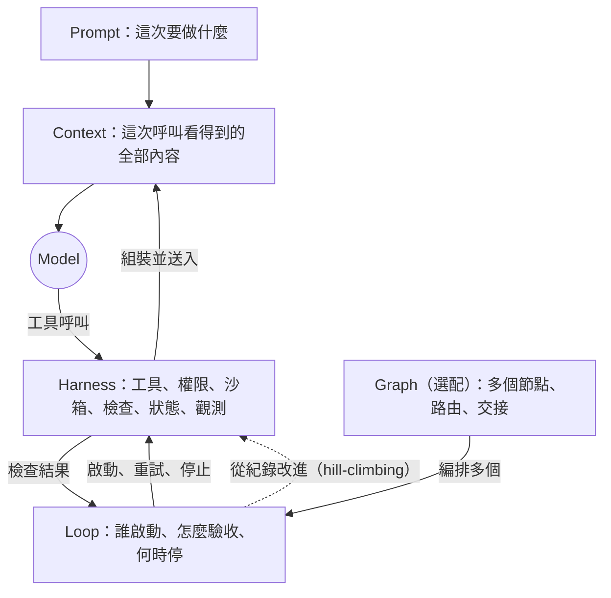

# Agent 工程五層檢查表：全文紀錄與檢視

**狀態：** 原始檢查表與檢視提案的歷史紀錄；第 3 節原文保留不改。後續決定以正式 spec 為準。
**日期：** 2026-11-03
**檢視對象：** [Agent 工程五層檢查表（Claude Artifact）](https://claude.ai/artifact/3fQDhdVvAYqZDhvNRpnjeT)，頁面標示「整理 2026.10」
**相關文件：**
[五層工具正式 spec](./2026-11-03-five-layer-tool-spec.md)、
[新版實作計畫](../plans/2026-11-03-five-layer-tool-implementation.md)。舊設計 spec 與舊實作計畫已於 2026-11-04 移除

## 1. 背景與目的

舊設計文件（已移除）的未解事項曾寫著：
Claude Artifact 只能抓到用戶端渲染的外殼，無法逐行比對。本次改用瀏覽器渲染頁面，
並直接從 artifact 的 iframe 取出題目資料與判斷邏輯，所以可以補上全文。

本文件的目的：

1. 留存 artifact 全文與行為，作為後續修改的比對基準。
2. 整理 Prompt、Context、Harness、Loop、Graph 五個名詞的定義與彼此關係。
3. 列出檢視結果與修改提案，供後續討論決定。

非目標：本文件不修改 artifact，也不改變工具組 v1 scanner 的範圍。

## 2. 取得方式與限制

- **取得時間：** 2026-11-03。
- **取得方式：** 用 VS Code 整合瀏覽器開啟 artifact，透過 Playwright 讀取 iframe 的
  `document.body.innerText`，以及 inline script 裡的 `LAYERS` 資料和 `render()` 函式。
- **行為測試：** 實際勾選一組情境（見 3.6），測完已清回 0/27。
- **儲存方式：** 勾選狀態存在瀏覽器 `localStorage`，key 為 `five-layer-check-v1`；
  題目 ID 格式為 `c-{層}-{序}`，例如 `c-1-3`。
- **未保存：** CSS 與剖面圖的視覺設計、artifact 的修改歷史。artifact 日後更新時，
  第 3 節的全文就會過期。

## 3. Artifact 全文

以下文字逐字取自 artifact。為了方便討論，本文件替每一題加上編號（P1–P4、C1–C5、
H1–H8、L1–L5、G1–G5），artifact 本身沒有這些編號。

### 3.1 頁首

- 眉標：`AGENT ENGINEERING ／ 剖面圖`
- 標題：`Agent 工程五層檢查表`（「五層」以螢光筆標示）
- 導言：`由內到外，一層包一層。內層沒做好，外層救不回來。27 題，勾一勾，看你的專案做到哪一層。`
- 圖說欄位：

  | 欄位 | 內容 |
  |---|---|
  | 圖名 | Agent 工程剖面 |
  | 層數 | 5 |
  | 檢查題 | 27 |
  | 整理 | 2026.10 |

- 導覽列：五個按鈕，顯示層號與該層進度（例如 `1`、`0/4`）。

### 3.2 剖面圖

- 標題列：`剖面 A–A`、`外 → 內`
- 同心圓由外到內：`5 Graph 協作圖`、`4 Loop 迴圈`、`3 Harness 外圍`、
  `2 Context 情境`、`1 Prompt 提示詞`，圓心是 `模型 MODEL`。每一圈顯示該層進度。
- 總計：`0/27 題已勾`
- 說明：`點任何一圈，跳到那一層的檢查題。勾得越多，那一圈的螢光筆塗得越滿。`

### 3.3 各層內容

每一層都有相同的欄位：層號、英文名、中文名、一句話問題、定義、英文引文與出處、
「文章點名的組成」、檢查題。

#### 第 1 層 Prompt 提示詞

| 欄位 | 內容 |
|---|---|
| 問題 | 一次怎麼問。 |
| 定義 | 一次呼叫裡，模型讀到的那段文字。 |
| 引文 | “Prompt is the string the model reads in one call.” |
| 出處 | Archit Dwivedi |
| 文章點名的組成 | 角色、範例、步驟拆解、輸出格式約定 |

| 編號 | 檢查題 |
|---|---|
| P1 | 專案指引只有一份，所有 agent 讀同一份 |
| P2 | 重複出現的工作，寫成了固定做法 |
| P3 | 每個專責 agent 有自己的角色說明 |
| P4 | 輸出格式有事先約定 |

#### 第 2 層 Context 情境

| 欄位 | 內容 |
|---|---|
| 問題 | 它這一刻看得到什麼。 |
| 定義 | 模型這一刻看得到的全部內容：提示詞，加上查回來的文件、對話歷史、工具結果。 |
| 引文 | “Context is everything in the model's window. Prompt plus retrieved docs, history, tool results.” |
| 出處 | Archit Dwivedi |
| 文章點名的組成 | 檢索、排序、逐步揭露、引用、摘要或捨棄 |

| 編號 | 檢查題 |
|---|---|
| C1 | 專案知識有索引，agent 先讀索引再讀細節 |
| C2 | 該看的規範，會在對的時機自動出現 |
| C3 | 踩過的坑有固定存放的地方 |
| C4 | 程式碼結構查得到，不用整檔讀 |
| C5 | 什麼原文引用、什麼摘要、什麼不放，有規則 |

#### 第 3 層 Harness 外圍

| 欄位 | 內容 |
|---|---|
| 問題 | 系統要擋什麼、量什麼、修什麼。 |
| 定義 | 單一 agent 外面那一圈：工具、執行環境、權限、驗證。 |
| 引文 | “Harness engineering is about what should the system prevent, measure, and correct.” |
| 出處 | Thiyagarajan M |
| 文章點名的組成 | 工具、狀態與記憶、執行環境與沙箱、權限邊界、驗證迴圈、評測、復原 |

資料中的題目以「擋：」、「修：」、「量：」開頭，畫面上會把這個字顯示成標籤。

| 編號 | 檢查題（原始資料） |
|---|---|
| H1 | 擋：機器能判定的規範，交給 lint 和 CI 硬擋 |
| H2 | 擋：要靠理解的規範，有指定誰來審 |
| H3 | 擋：agent 的權限邊界有設 |
| H4 | 擋：每件工作有隔離的執行環境 |
| H5 | 修：寫完會自動檢查 |
| H6 | 修：出錯之後能復原或重來 |
| H7 | 量：成本和耗時看得到 |
| H8 | 量：agent 做對幾成，算得出來 |

#### 第 4 層 Loop 迴圈

| 欄位 | 內容 |
|---|---|
| 問題 | 做到什麼時候停。 |
| 定義 | 一個 agent 自己重複做，直到條件成立才停。 |
| 引文 | “discover → plan → execute → verify → repeat until a condition holds.” |
| 出處 | Shirley, AI Builder Club |
| 文章點名的組成 | 可測試的停止條件、驗證器、觸發器 |

| 編號 | 檢查題 |
|---|---|
| L1 | 目標有可以測試的停止條件 |
| L2 | 每一圈都有驗證步驟 |
| L3 | 重試有上限，超過會交給人 |
| L4 | 每一圈都留下紀錄 |
| L5 | 誰來啟動這個迴圈，有定義 |

#### 第 5 層 Graph 協作圖

| 欄位 | 內容 |
|---|---|
| 問題 | 誰接誰、走哪條路。 |
| 定義 | 多個 agent 或步驟怎麼串：節點做事，邊決定走向，共用狀態沿著邊傳。 |
| 引文 | “Graph engineering is the practice of representing an entire AI app — or an entire team of agents — as an explicit graph: nodes that do work, edges that route state between them.” |
| 出處 | Sarthak Rastogi |
| 文章點名的組成 | 節點、邊、共用狀態 |

| 編號 | 檢查題 |
|---|---|
| G1 | 每種工作有專責的節點 |
| G2 | 走向由程式決定，agent 不能自己跳關 |
| G3 | 整件事只有一份共用紀錄 |
| G4 | 人的核准點畫進圖裡 |
| G5 | 路徑上的檢查有寫明 |

### 3.4 結果區

- 區塊標題：`你的剖面`，列出五層的進度條與 `已勾/總數`。
- 建議區有三行文字，依狀態變化：

  | 狀態 | 第一行 | 第二行 | 第三行 |
  |---|---|---|---|
  | 一題都沒勾 | `從最內層開始` | `第 N 層 {英文} {中文}` | `這層還差 K 題。外層蓋在內層上面，最內側還沒勾滿的那一層最該先補。` |
  | 有勾但未全滿 | `先補這一層` | 同上 | 同上 |
  | 27 題全勾 | `全部勾滿` | `五層都到位了` | `接下來的工作是讓每一題持續成立，工具換了也一樣。` |

- 可分享的結果文字（每項一行，名稱與進度之間是全形空白）：

  ```text
  Agent 工程五層檢查：{已勾}/27
  1 Prompt 提示詞　{d}/4
  2 Context 情境　{d}/5
  3 Harness 外圍　{d}/8
  4 Loop 迴圈　{d}/5
  5 Graph 協作圖　{d}/5
  先補：第 N 層 {英文}        ← 全勾時改為「五層都勾滿」
  ```

- 按鈕：
  - `複製結果`：成功顯示 `已複製`；失敗時會選取文字並顯示 `已選取文字，請手動複製`。
  - `清除勾選`：第一次按下會變成 `再按一次清除`，3 秒內再按一次才會清除，並顯示 `已清除`。

### 3.5 頁尾

> 各層的定義和引文出自下列文章。檢查題整理自這些文章點名的組成，加上實務做法。這套五層分法是社群的說法，目前沒有官方標準。

- Archit Dwivedi，[Prompt → Context → Harness: three layers of LLM engineering](https://blog.archit0.com/2026/05/03/prompt-context-harness/)，2026-05-03
- Shirley（AI Builder Club），[The 5 Layers of AI Engineering](https://www.aibuilderclub.com/blog/five-layers-ai-engineering)，2026-07-20
- Sarthak Rastogi，[Harness, Graph, and Loop Engineering](https://sarthakai.substack.com/p/harness-graph-and-loop-engineering)，2026-08-04
- Thiyagarajan M，[Harness Engineering Is Not Context Engineering](https://mtrajan.substack.com/p/harness-engineering-is-not-context)，2026-02-16

> 勾選狀態只存在你這台裝置的瀏覽器裡。

### 3.6 判斷規則與實測

`render()` 的邏輯：

```text
first = 由第 1 層往第 5 層找，第一個「已勾 < 題數」的層
if first 不存在: 顯示「全部勾滿 / 五層都到位了」
else:            建議「先補第 first 層」，並顯示該層還差幾題
```

規則只看每層有沒有勾滿，不看題目是否適用、也不看實際症狀。

實測情境：Prompt 勾 P1、P2、P4（只缺 P3），Context 勾滿 5/5，結果顯示
`先補：第 1 層 Prompt`。也就是說，單一 agent 的專案因為 P3 不適用，
會一直被建議先補第 1 層，Graph 沒勾滿也永遠到不了「全部勾滿」。

## 4. 引文與來源核對

### 4.1 引文

| 層 | 核對結果 |
|---|---|
| Prompt | 與 Archit 原文一致。 |
| Context | 與 Archit 原文一致（原文 apostrophe 為彎引號，不影響內容）。 |
| Harness | 與 Thiyagarajan 原文一致。 |
| Loop | 與 Shirley 原文一致。 |
| Graph | **有刪節但未標示。** 原文為 “nodes that do work (agents, tools, deterministic functions, humans), edges that route state between them, and it’s genuinely broader than LangGraph, GraphRAG, or knowledge graphs…”。artifact 刪掉括號內容，並在 “between them” 後直接加句號。 |

### 4.2 「文章點名的組成」的實際來源

artifact 把這一欄排在引文正下方，看起來像引文作者的說法，實際來源如下：

| 層 | 組成 | 實際來源 |
|---|---|---|
| Prompt | 角色、範例、步驟拆解、輸出格式約定 | Shirley 的 Layer 1 原文：“a role, a few examples, a step-by-step decomposition, an output-format contract”。Archit 的列法相近但不同：“Roles, instructions, examples, output format.” |
| Context | 檢索、排序、逐步揭露、引用摘要或捨棄 | Shirley 的 Layer 2 原文：“retrieval, ranking, progressive disclosure, and … what to quote versus summarize versus cut.” |
| Harness | 工具、狀態與記憶、執行環境與沙箱、權限邊界、驗證迴圈、評測、復原 | 綜合兩篇：Sarthak 列 “tools, execution environment, memory, sandboxing, verification loops, permission boundaries”；評測、復原來自 Shirley 的 harness 六個組成（context, tools, orchestration, state, evaluation, recovery）。不是來自上方引文作者 Thiyagarajan。 |
| Loop | 可測試的停止條件、驗證器、觸發器 | Shirley 原文：“a goal with a testable stop condition, a verifier …, and a trigger”。 |
| Graph | 節點、邊、共用狀態 | Shirley 原文：“Nodes / Edges / Shared state”。 |

### 4.3 頁尾來源

| 來源 | 核對結果 |
|---|---|
| Archit | 標題一致。發布時間為 UTC 2026-05-02 20:41，即台灣時間 05-03，與網址路徑一致。 |
| Shirley | 標題、日期一致。 |
| Sarthak | 日期一致。標題省略副標「— How to Evolve From Prompts and Context」。 |
| Thiyagarajan | 標題、日期一致。 |

## 5. 五個名詞的關係

### 5.1 核對方式

- **本次直接核對：** 抓取原文並比對引文或摘要。
- **研究子代理核對：** 由研究子代理抓取原文並回報，本次未再逐字比對。
- **二手來源：** X 貼文無法直接抓取，日期與引文來自轉述，視為未核對。

### 5.2 定義與代表來源

| 名詞 | 本文採用的工作定義 | 代表來源與日期 | 核對 |
|---|---|---|---|
| Prompt | 一次呼叫裡的指令文字：目標、限制、範例、輸出格式。 | Anthropic, [Effective context engineering for AI agents](https://www.anthropic.com/engineering/effective-context-engineering-for-ai-agents)（2025-09-29）：“Prompt engineering refers to methods for writing and organizing LLM instructions for optimal outcomes.” | 直接 |
| Context | 一次呼叫時模型看得到的全部 token：指令、工具定義、檢索結果、歷史、工具輸出。 | 同上 Anthropic 文章：“we view context engineering as the natural progression of prompt engineering.”；LangChain, Context Engineering for Agents（2025-07-02，write／select／compress／isolate）；Drew Breunig, How Long Contexts Fail（2025-06-22）；Lütke（2025-06-19）、Karpathy（2025-06-25）的 X 貼文 | Anthropic 直接；LangChain、Breunig 子代理；X 貼文二手 |
| Harness | 模型以外、讓 agent 能做事的一切：工具、權限、沙箱、檢查、狀態、觀測。 | Mitchell Hashimoto, [My AI Adoption Journey](https://mitchellh.com/writing/my-ai-adoption-journey)（2026-02-05）；OpenAI, [Harness engineering](https://openai.com/index/harness-engineering/)（2026-02）；LangChain, [The Anatomy of an Agent Harness](https://www.langchain.com/blog/the-anatomy-of-an-agent-harness)（2026-03-10）：“If you're not the model, you're the harness.”；Birgitta Böckeler, [Harness engineering for coding agent users](https://martinfowler.com/articles/harness-engineering.html)（2026-04-02） | Hashimoto、LangChain、Fowler 直接；OpenAI 內文直接，作者與確切日期（02-11）子代理 |
| Loop | 誰啟動 agent、怎麼驗收、何時停、怎麼從結果改進。 | Addy Osmani, [Loop Engineering](https://addyosmani.com/blog/loop-engineering/)（2026-06-07）：“Loop engineering sits one floor above the harness.”；LangChain, [The Art of Loop Engineering](https://www.langchain.com/blog/the-art-of-loop-engineering)（2026-06-16）；Lulla et al., [arXiv:2608.21884](https://arxiv.org/abs/2608.21884)（v3, 2026-10-22） | 直接 |
| Graph | 用明確的節點、邊與共用狀態組織多個 agent 或步驟，決定誰接誰、走哪條路。 | Feng et al., [arXiv:2608.21156](https://arxiv.org/abs/2608.21156)；Sarthak Rastogi（2026-08-04）；Shirley（2026-07-20）；LangGraph 文件 | Feng、Sarthak、Shirley 直接；LangGraph 子代理 |

### 5.3 兩種看法

1. **時間順序：** 業界關注的焦點逐年往外移。Lulla et al. 的摘要寫道：
   “from phrasing prompts to engineering context to configuring the harness around the underlying model.”
2. **不同維度：** 五個名詞各管不同的事，彼此會互相影響，不是單純外層包內層。

實務部落格（Shirley、Sarthak、Archit）多採用同心圓說法，例如 Sarthak：
“Each layer contains the one below it.” 本文的看法是：同心圓可以描述執行時誰包住誰，
但不適合當成「由內往外依序補完」的成熟度順序。

### 5.4 兩兩之間的關係



1. **Prompt 在 Context 裡面。** 各來源一致。
2. **Context 和 Harness 誰包誰，取決於角度。**
   - LangChain：Agent = Model + Harness，管理 context 是 harness 的一部分。
   - Fowler／Böckeler：“Engineering a user harness for a coding agent is a specific form of context engineering.”
   - 本文的整合：Harness 是產生 context 的機器，Context 是 Harness 送進模型的結果。
3. **Harness 和 Loop 會互相影響。**
   - 內層迴圈（model ↔ tool）屬於 Harness。Archit：“The harness owns the `while`.”
   - Loop engineering 講的是外層迴圈。LangChain 分四層：agent、verification、event-driven、hill-climbing。
   - 第四層會 “rewrite the harness with improved configuration”，也就是 Loop 會回頭修改 Harness。
   - Hashimoto 對 harness engineering 的定義本身就是一個改進迴圈：
     “anytime you find an agent makes a mistake, you take the time to engineer a solution such that the agent never makes that mistake again.”
4. **Loop 和 Graph 是兩種決定路徑的方式。**
   - Sarthak：“A single loop is the smallest possible graph”；差別在於 “who decides the path — the agent or you.”
   - Feng et al. 把 Graph 定位為系統層級：“Augmenting one agent's capabilities or context cannot resolve this architectural mismatch; intelligence must instead be distributed across specialized agents and organized at the system level.”
   - Sarthak：“Most tasks never need a complex graph.”

### 5.5 來源之間的分歧

| 分歧 | 一方 | 另一方 |
|---|---|---|
| Context 與 Harness 的包含關係 | LangChain、OpenAI：context 管理是 harness 的一部分 | Fowler／Böckeler：harness 是 context engineering 的一種形式 |
| Loop 在 Harness 之內或之上 | Archit、Sarthak：每個 agent 本來就是一個迴圈，harness 擁有 `while` | Osmani、LangChain、Lulla et al.：loop engineering 是 harness 之上的一層 |
| Graph 的定位 | Sarthak、Shirley：Loop 之上的下一層 | Feng et al.：不同的維度（系統層級）；Hamel Husain 的 X 文章稱 “Loop Engineering Is Dead”（二手，未核對） |
| 是否為成熟度階梯 | Shirley：“The five layers aren't a menu - they're a ladder” | Shirley 同文也主張依症狀找 “the lowest layer that's still your bottleneck”；Sarthak 與 Shirley 都引用懷疑者的看法 |

### 5.6 證據強度

- **實證研究：**
  - Lulla et al.（[arXiv:2608.21884](https://arxiv.org/abs/2608.21884)，JAWs@ASE 2026）：
    灰色文獻對好迴圈的組成有共識——由排程或 repo 事件啟動、機器可檢查的停止條件、
    持久狀態檔、驗證用的子 agent、token 預算、明確的人工升級點——但
    “These sources provide no systematic evidence of the claimed benefits.”
    掃描 36,710 個 repo，只在 217 個找到自主迴圈；幾乎都提交了啟動設定，
    卻幾乎沒有提交狀態檔。
  - Gloaguen et al.（[arXiv:2602.11988](https://arxiv.org/abs/2602.11988) v3）：
    context 檔 “does not generally improve task success rates, while increasing inference cost by over 20% on average”；
    結論對 LLM 生成與開發者撰寫的檔案都成立；指令會被遵守，但 “repository overviews … are not helpful”；
    context 檔適合用來寫 “non-standard coding practices”。
  - Feng et al.（[arXiv:2608.21156](https://arxiv.org/abs/2608.21156)）：綜述與框架，不是實證比較。
- **廠商工程部落格：** Anthropic、OpenAI、LangChain。有內部案例，沒有對照實驗。
- **實務者文章：** Hashimoto、Fowler／Böckeler、Osmani，以及 artifact 引用的 4 篇部落格。
- **X 貼文：** Lütke、Karpathy、Steinberger、Husain 等，本次未直接核對。

## 6. 檢視結果

嚴重度定義：

- **P0：** 會給出錯誤建議。
- **P1：** 分層放錯或定義不一致。
- **P2：** 缺少有來源支持的題目或判斷方式。
- **P3：** 引用與標示問題。

所有項目狀態皆為「待討論」。

### P0：會給出錯誤建議

**F-01　P3 放在 Prompt 層，單一 agent 專案會一直卡在第 1 層。**

- 證據：判斷規則只找第一個沒勾滿的層（3.6）。實測 Context 全滿、Prompt 只缺 P3 時，
  仍顯示「先補：第 1 層 Prompt」。Sarthak 也把 “Agent role definitions” 列在 Graph engineering 底下。
- 提案：P3 移到 Graph 層，或標示為「多 agent 才適用」。

**F-02　Graph、Loop 沒有「不適用」選項。**

- 證據：Sarthak：“Most tasks never need a complex graph.” Shirley：climb to graph
  “only when one loop genuinely can't hold the work”。不需要 Graph 的專案永遠到不了「全部勾滿」。
- 提案：每題提供「不適用」，或在 Graph 層開頭加一道判斷題「這件事真的需要多個 agent 或分支嗎？」，
  答「否」時整層不計分。

**F-03　「內層沒做好，外層救不回來」與「先補最內層」說得比來源更強。**

- 證據：
  - Shirley 的建議是從看得到的症狀找層：“Start from the symptom you can actually observe”，
    並修 “the lowest layer that's still your bottleneck”。沒勾滿不等於是瓶頸。
  - Thiyagarajan 引用 OpenAI 的做法：linter 錯誤訊息 “doubled as context for the next attempt”，
    外層可以部分補救內層。
  - [正式 spec](./2026-11-03-five-layer-tool-spec.md) 延續舊設計的立場：這五層
    「不是強制的同心圓架構，也不是驗證過的成熟度階梯」。
- 提案：改用 Shirley 的「症狀 → 層」表決定先補哪裡；同心圓視覺可以保留，
  但刪掉「救不回來」，也不再用勾選數決定順序。

### P1：分層放錯或定義不一致

**F-04　Prompt 層的定義與題目對不上。**

- 證據：定義是「一次呼叫裡的文字」，但 P1、P2 談的是長期存在 repo 的檔案
  （AGENTS.md、skills），屬於 Context；Fowler 的表格也把 AGENTS.md、Skills 歸為 harness 的 feedforward guides。
  Prompt 層反而缺少核心的「任務目標、限制、驗收條件」，Shirley 的症狀表把「解錯問題」對應到 Prompt。
- P1「只有一份」也與漸進揭露的做法衝突。Thiyagarajan 轉述 OpenAI：“Instead of a giant instruction file, a small AGENTS.md pointed to deeper sources of truth”。
- 提案：P1、P2 移到 Context。P1 改寫為「專案指引有單一權威來源，內容不互相矛盾（可分層、依路徑載入）」。
  Prompt 層新增「任務的目標、限制、驗收條件有寫清楚」。

**F-05　Loop 層只涵蓋內層迴圈，缺少「從結果改進」。**

- 證據：定義「一個 agent 自己重複做，直到條件成立才停」只描述 agent loop。
  LangChain 稱 hill-climbing 迴圈 “arguably most important”，它會改寫 harness。
- 提案：定義改為「誰啟動、怎麼驗收、何時停、怎麼從結果改進」，並新增 hill-climbing 題目（見 F-09）。

**F-06　H5 與 L2 重複。**

- 證據：H5「寫完會自動檢查」、L2「每一圈都有驗證步驟」問的是同一件事。
- 提案：Harness 負責「提供檢查機制」，Loop 負責「用檢查結果決定下一步」（繼續、重試、交給人、停止）。
  這也符合 Fowler 的 guides（feedforward）與 sensors（feedback）區分。

**F-07　G2「走向由程式決定，agent 不能自己跳關」太絕對。**

- 證據：Sarthak 列出的 Graph 模式包含 model-based router 與 orchestrator-worker，路由可以由模型決定。
- 提案：改為「可走的路徑事先宣告，agent 只能在這些路徑裡選，不能跳過檢查點」。

**F-08　G3「整件事只有一份共用紀錄」與 context 隔離衝突。**

- 證據：LangChain 的 context 策略包含 isolate；Archit：“Sub-agents are this same loop nested with isolated context”；
  Sarthak 談 handoff 時要避免 “repeating full context at every boundary”。
- 提案：改為「共用狀態有明確結構和單一權威來源，各節點只拿自己需要的部分」。

### P2：建議新增的題目與判斷方式

**F-09　建議新增的題目。**

| 層 | 新增題目 | 依據 |
|---|---|---|
| Prompt | 任務的目標、限制、驗收條件有寫清楚 | Shirley 症狀表 |
| Context | 指引只寫非標準做法，不寫專案概覽，也不重複 lint 已擋的規則 | Gloaguen et al. v3；Dos Santos et al. [arXiv:2606.15828](https://arxiv.org/abs/2606.15828)（子代理核對） |
| Context | 過期的文件有人清 | Thiyagarajan 轉述 OpenAI 的背景清理 agent |
| Harness | 錯誤訊息寫成能教 agent 怎麼修 | Thiyagarajan：“linter errors were written to teach” |
| Harness | agent 看得到 log、畫面、指標 | Thiyagarajan 轉述 OpenAI 的 Chrome DevTools 與觀測堆疊 |
| Harness | 外部內容（網頁、issue、檢索結果）視為不可信 | Archit：“dealing with prompt injection inside retrieved content” |
| Loop | 驗證器不能被 agent 繞過（例如改測試、刪測試） | Shirley：弱驗證器會 “succeeds at producing garbage”；Verification Horizon（[arXiv:2606.26300](https://arxiv.org/abs/2606.26300)）的 robustness 維度 |
| Loop | 有花費上限，不只次數上限 | Lulla et al. 共識中的 token budgets |
| Loop | 同一種錯出現第二次，就變成規則、測試或工具 | Hashimoto；LangChain hill-climbing |
| Graph | 交接格式有定義（A 交給 B 什麼） | Sarthak：“Handoff protocols” |

另外，C1「專案知識有索引」需留意：Gloaguen et al. 發現 repository overview 沒有幫助。
索引應該指向細節，而不是概覽本身。

**F-10　勾選只代表「有做」，不代表「有效」或「被強制」。**

- 證據：Lulla et al. 發現幾乎所有迴圈都提交了啟動設定，卻幾乎沒有狀態檔；
  舊設計文件（已移除）區分 artifact presence、operational enforcement、task outcome；正式 spec 以證據等級延續此區分。
- 提案：每題改為三種狀態：「沒有／有但靠自覺（文件寫了）／系統強制（hook、CI、權限設定）」，外加「不適用」。

### P3：引用與標示

**F-11　Graph 引文刪節未標示。** 補上「…」，或保留 “(agents, tools, deterministic functions, humans)”。
括號內的 “humans” 正好支撐 G4「人的核准點畫進圖裡」。

**F-12　「文章點名的組成」與上方引文作者不同。** 依 4.2 標示實際來源，或改稱「綜合整理」。

**F-13　來源只有 4 篇個人部落格。** 補上 Anthropic、OpenAI、Fowler、LangChain 的一手文章，
以及 Lulla et al.、Gloaguen et al. 的實證結果，避免讓人以為每一層都已證實有效。
Sarthak 的標題可補上副標。

## 7. 與既有文件的關係

### 7.1 對工具組設計 spec 的影響

- **可結案：** 未解事項「Claude Artifact 的內容需要提供或匯出」已由本文件第 3 節解決。
- **既有衝突：** artifact 採同心圓與「先補最內層」，spec 則明定不是同心圓架構、不是成熟度階梯，
  且 Graph 為選配（見 F-02、F-03）。
- **引用修正建議：**
  - spec 寫 “Baltes et al., arXiv:2608.21884”，第一作者其實是 Jai Lal Lulla，Baltes 是最後一位作者，應改為 “Lulla et al.”。
  - spec 的 research basis 把 LangChain “The Art of Loop Engineering” 列了兩次。
  - spec 說 2602.11988 中開發者撰寫的檔案比 LLM 生成的高 7%；v3 摘要未提到這點，
    且說結論對兩種檔案都成立，需要對照全文確認。
- **題數差異：** 舊實作計畫（已移除）提到 v3.2 skill 使用 32 項 heuristic，
  artifact 是 27 題。本 repo 沒有 v3.2 workbench HTML，無法確認兩者的關係。

### 7.2 27 題與 v1 scanner 的初步對應

v1 scanner 只能確認檔案存在（artifact presence）。下表是初步對應，待討論。

| 題目 | v1 可觀察的訊號 | 其餘需要的證據 |
|---|---|---|
| P1 | `instruction-file-found` | 是否單一來源、內容是否矛盾：人工判斷 |
| P2 | `skill-location-found`、`skill-metadata-valid` | 其他形式（prompt 檔、腳本）與實用性：人工判斷 |
| P3 | 無（自訂 agent 檔不在 v1 搜尋清單） | 人工判斷 |
| P4 | 無 | 人工判斷 |
| C1 | `instruction-file-found`、`context-size-reported`（僅資訊） | 是否為索引：人工判斷 |
| C2 | `instruction-file-found`（含 `.github/instructions/**`）、`skill-location-found` | 是否在對的時機載入：執行期 |
| C3、C4、C5 | 無 | 人工判斷或執行期 |
| H1 | `ci-config-found` | 是否硬擋（required checks、branch protection）：`evidence-gap-reported` 回報 unknown |
| H2 | 無（CODEOWNERS 不在 v1 範圍） | 遠端審查規則：unknown |
| H3 | 無（不解析廠商權限設定） | `evidence-gap-reported` |
| H4、H6、H7 | 無 | 執行期 |
| H5 | `ci-config-found`（部分） | hook 不在 v1 範圍；是否實際執行：執行期 |
| H8 | 無 | task outcome，見設計 spec 的後續評測協定 |
| L1、L2、L3、L4 | 無 | 人工判斷或執行期 |
| L5 | `ci-config-found`（部分，event-driven 標籤） | spec 明定不得推論 CI 就是 agent 迴圈 |
| G1–G5 | 僅 `--graph-applicability` 使用者輸入 | 人工判斷 |

結論：27 題中只有約 7 題有 v1 訊號，而且都只能證明檔案存在。檢查表本質上是自我評估工具，
scanner 是證據工具，兩者是互補關係。

## 8. 修改提案草稿（待討論）

以下整合第 6 節的提案。若全部採納，題數會從 27 題增加到約 38 題，需要再精簡（見 Q5）。

| 層 | 編號 | 動作 | 提案文字 |
|---|---|---|---|
| Prompt | 新 | 新增 | 任務的目標、限制、驗收條件有寫清楚 |
| Prompt | 新 | 新增 | 需要時附上範例 |
| Prompt | 新 | 新增 | 大任務先拆成步驟 |
| Prompt | P4 | 保留 | 輸出格式有事先約定 |
| Context | P1 | 移入並改寫 | 專案指引有單一權威來源，內容不互相矛盾（可分層、依路徑載入） |
| Context | P2 | 移入並改寫 | 重複出現的工作，寫成可重用的做法（skill、prompt 檔、腳本） |
| Context | C1 | 改寫 | 專案知識有索引，agent 先讀索引再讀細節；索引指向細節，不放概覽 |
| Context | C2–C5 | 保留 | 原文 |
| Context | 新 | 新增 | 指引只寫非標準做法，不重複 lint 已擋的規則；過期內容有人清 |
| Harness | H1–H4、H6–H8 | 保留 | 原文 |
| Harness | H5 | 改寫 | 修：改完有自動檢查可以跑（測試、lint、型別檢查） |
| Harness | 新 | 新增 | 修：錯誤訊息寫成能教 agent 怎麼修 |
| Harness | 新 | 新增 | 量：agent 看得到 log、畫面、指標 |
| Harness | 新 | 新增 | 擋：外部內容視為不可信 |
| Loop | 定義 | 改寫 | 誰啟動、怎麼驗收、何時停、怎麼從結果改進 |
| Loop | L1、L5 | 保留 | 原文 |
| Loop | L2 | 改寫 | 每一圈都用檢查結果決定下一步（繼續、重試、交給人、停止） |
| Loop | L3 | 改寫 | 重試和花費都有上限，超過會交給人 |
| Loop | L4 | 改寫 | 每一圈留下可接續的紀錄（狀態檔、進度） |
| Loop | 新 | 新增 | 驗證器不能被 agent 繞過 |
| Loop | 新 | 新增 | 從紀錄找出重複的錯，改成規則、測試或工具 |
| Graph | 新 | 新增（判斷題） | 這件事真的需要多個 agent 或分支嗎？（否 → 整層不適用） |
| Graph | G1、G4、G5 | 保留 | 原文 |
| Graph | P3 | 移入 | 每個專責 agent 有自己的角色說明 |
| Graph | G2 | 改寫 | 可走的路徑事先宣告，agent 只能在這些路徑裡選，不能跳過檢查點 |
| Graph | G3 | 改寫 | 共用狀態有明確結構和單一權威來源，各節點只拿自己需要的部分 |
| Graph | 新 | 新增 | 交接格式有定義（A 交給 B 什麼） |
| 全域 | 判斷規則 | 改寫 | 用「症狀 → 層」決定先補哪裡，不用勾選數 |
| 全域 | 勾選狀態 | 改寫 | 沒有／靠自覺／系統強制／不適用 |
| 全域 | 導言 | 改寫 | 刪掉「內層沒做好，外層救不回來」 |
| 全域 | 引用 | 修正 | 依 F-11 至 F-13 處理 |

## 9. 待討論問題

- **Q1　視覺模型：** 保留同心圓剖面圖，或改成「維度＋症狀診斷」？
- **Q2　判斷規則：** 「最內層未滿」、「症狀 → 層」、或讓使用者自選瓶頸？
- **Q3　不適用的粒度：** 每題都可標示，還是只在層級設判斷題？
- **Q4　勾選狀態：** 維持二元，或改成三態加不適用？
- **Q5　題數上限：** 採納全部提案會到約 38 題，要精簡到多少？
- **Q6　與 scanner 的關係：** 檢查表要不要成為 scanner 報告的 HTML client，
  共用同一份 check catalog？設計 spec 目前規定 workbench 只能匯入 scanner 的 schema。
- **Q7　來源政策：** 維持實務部落格為主，或加入一手與實證來源？
- **Q8　受眾與語言：** 給個人自評、團隊討論，還是對外分享？是否需要英文版？
- **Q9　既有文件：** 是否依 7.1 修正設計 spec 的引用與未解事項？
